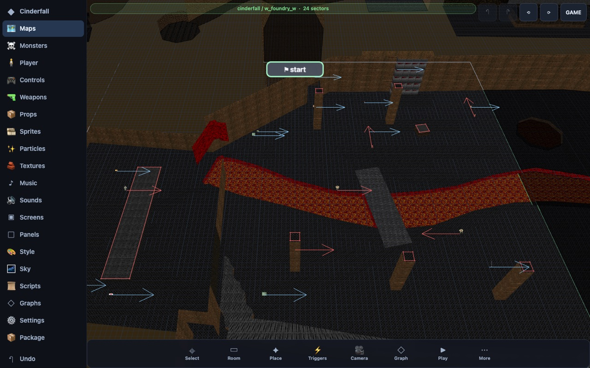

# Digidream Studio

The editor for games on the Digidream engine. A game is a **module**: its
maps, monsters, weapons, props, textures, sprites, sounds, music, screens and
scripts. The Studio edits all of it and plays it at once. It works with a
mouse or a finger: on a desktop, a tablet or a phone.



## Download

From the [latest release](https://github.com/projectdigidream/digidream-studio/releases/latest):

| platform | file | |
|---|---|---|
| Windows | `digidream-studio-<version>-windows-x64.zip` | unzip, run the `.exe` |
| macOS (Apple silicon) | `digidream-studio-<version>-macos-arm64.zip` | unzip, open the app |
| macOS (Intel) | `digidream-studio-<version>-macos-x64.zip` | |
| Linux | `digidream-studio-<version>-linux-x64.tar.gz` | unpack, run the launcher |
| Android | `digidream-studio-<version>-android.apk` | sideload it |

Each also comes as `digidream-studio-noplugins-...`: the same Studio without
the bundled editors (below), smaller.

**macOS:** the app is signed ad hoc but not notarized, so the first time macOS
says it "could not verify" it. Open **System Settings > Privacy & Security**,
scroll to the message about the Studio and click **Open Anyway**.

## Your first room

1. The Studio opens on **Home**, with a module made from the starter: a room,
   a door, a pit, a platform and a spirit. **New module** makes another one.
2. Tap the map under **Maps** to open the map editor.
3. Pick the **Room** tool (key `2`). Tap corners and close on the first one,
   or drag a rectangle. A new room takes the module's textures; change them
   in its inspector, or import your own under **Textures**.
4. Select a room to raise its floor or lower its ceiling. **Place** puts
   monsters, props and lights; **Triggers** wires doors, lifts and switches.
5. **Play** runs the module in the engine, from the map you are on.

The examples on Home, **Gem Hollow** (a small platformer) and **Cinderfall**
(a non-linear shooter), open as modules of their own to look inside.

## The module

The rail on the left (or Home, on a phone held upright) lists everything a
module has: Maps (and a metamap, maps placed side by side as one world),
Monsters, Player, Controls, Weapons, Props, Sprites, Particles, Textures,
Music, Sounds, Screens, Panels, Style, Sky, Scripts, Graphs and Settings.

Your work is saved as you go, inside the Studio (with snapshots to go back
to). **Export** writes the module as a zip; **Import pack** reads one.

## Bundled editors

The Studio opens other Digidream tools inside itself, on the module's files:

| editor | for | also standalone |
|---|---|---|
| ThreeSprite | animated billboard sprites with a 3D rig | [digidream-threesprite](https://github.com/projectdigidream/digidream-threesprite) |
| qPainter | pixel-art textures with a live 3D preview | [digidream-qpainter](https://github.com/projectdigidream/digidream-qpainter) |
| DigidreamSound | sound effects, made from recipes | [digidream-sound](https://github.com/projectdigidream/digidream-sound) |
| DigidreamSynth | music: tracks, piano roll, patches | [digidream-midisynth](https://github.com/projectdigidream/digidream-midisynth) |
| Code | the module's Lua scripts | |
| Packager | the module as an app (the **Package** page) | [digidream-packager](https://github.com/projectdigidream/digidream-packager) |

## Making it a game

The **Package** page builds the module into a standalone game for Android,
Windows, Linux or macOS, right in the Studio. It is the
[Packager](https://github.com/projectdigidream/digidream-packager), built in.
Each platform needs a **kit**, the engine prebuilt for it. The Studio ships
with the small ones (Android, and the Tauri desktop kits); the larger Electron
desktop kits can be downloaded from the
[engine's releases](https://github.com/projectdigidream/digidream-engine/releases)
(the Package page offers each one when it is missing).

## Run it from source

The Studio runs on the engine's code, so it needs the
[engine](https://github.com/projectdigidream/digidream-engine) checked out
beside it, as `engine` and `studio` in one folder:

```sh
mkdir digidream && cd digidream
git clone https://github.com/projectdigidream/digidream-engine.git engine
git clone https://github.com/projectdigidream/digidream-studio.git studio
```

Then follow the engine README's **Get started** (Emscripten, LuaJIT, the
builds and the development certificate), and:

```sh
cd engine
./scripts/build_mapc_wasm.sh            # the map compiler, for the Studio's bakes
./scripts/run_stack.sh --module starter
```

and open http://localhost:8080/studio/ in Chrome. The bundled editors are
already in `plugins/`; the other tools' repositories are not needed.

To build the Studio as an app:
`engine/scripts/make_app.sh --studio` (desktop) or
`engine/scripts/build_apk.sh --studio` (Android).

## Development

The tests are in `test/`. The pure ones run with Node from the folder that
holds `engine/` and `studio/`:

```sh
for t in studio/test/*.test.js; do node "$t" | tail -1; done
```

Some check the Studio's output with the engine's own tools (the server, the
map compiler), so they need the engine built. `page.test.js` and
`plugins.page.test.js` drive the Studio in Chrome and are opt-in: start the
engine's web server (`DNP_HTTP_PORT=8093 node engine/tools/devserver.js
--module starter`), then

```sh
DNP_STUDIO_PAGE_TEST=1 STUDIO_URL=http://localhost:8093/studio/ \
NODE_PATH=<dir with puppeteer-core>/node_modules node studio/test/page.test.js
```

Against the starter module three of its checks fail: they expect served
sprites, a sound bank and music that the starter does not have.

`tools/vendor_plugins.mjs` brings the bundled editors in from their
repositories at the commits `plugins.lock.json` pins.

## Licence

MIT, see [LICENSE](LICENSE). Bundled parts keep their own licences:
[THIRD_PARTY.md](THIRD_PARTY.md).
